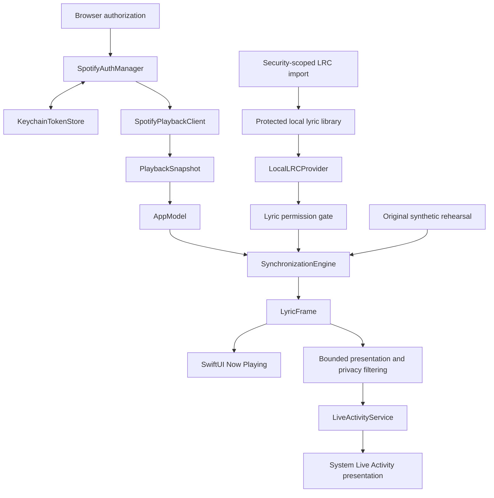

# Architecture

## Boundaries

CarLyrics separates playback observation, lyric ownership, synchronization, and system presentation. The portable Swift package contains no Apple interface framework. The iOS targets supply authentication UI, protected storage, file importing, SwiftUI views, and ActivityKit. This keeps parser, timing, playback decoding, authorization transitions, and presentation data testable without an iOS simulator.

| Component | Responsibilities | Dependencies |
| --- | --- | --- |
| `Sources/LyricsCore` | Track/playback models, timed lyric documents, LRC parsing, providers, playback estimation, active-line selection, bounded display data | Swift and Foundation |
| `ios/SpotifyIntegration` | PKCE, OAuth transactions, credential lifecycle, response decoding, playback reads, retry/backoff, transport mocks | Foundation, FoundationNetworking where needed, LyricsCore |
| `ios/ApplePlatformServices` | Browser authorization, Keychain, protected local library, configuration, Live Activity lifecycle | Public Apple frameworks and portable modules |
| `ios/CarLyricsApp` | Dependency composition, scene lifecycle, screens, observable state, imports/matching, diagnostics | SwiftUI and the services above |
| `ios/Shared` | Activity attributes and content schema compiled into both iOS targets | ActivityKit and Foundation |
| `ios/CarLyricsLiveActivity` | Lock Screen, Dynamic Island, and supplemental small/medium layouts | SwiftUI, WidgetKit, ActivityKit, shared attributes |

`Package.swift` exposes LyricsCore and SpotifyIntegration independently of the application. `ios/project.yml` creates the app and widget extension reproducibly through XcodeGen; local configuration supplies bundle identifiers, callback settings, and signing values.

## Application ownership and lifecycle

`AppModel` owns the production playback client, authorization manager, local library, synchronization engine, and activity service. The observable model runs on the main actor. LyricsCore uses immutable Sendable values and a mutable engine owned by that model; the local provider and Spotify clients use actors to serialize shared state.

Foreground tasks read Spotify approximately every five seconds and sample the estimated clock every 100 milliseconds. Each successful response replaces the playback anchor, corrects drift, and handles Spotify pause/resume or seeking. Generation counters prevent an older network/import/authentication result from replacing a newer mode, track, or request. A track-ID change clears old lyrics before another provider lookup can supply a document.

Scene transitions cancel polling and sampling. Missing freshness, network errors, or loss of authorization pause the estimate and mark activity content stale. These tasks do not confer background execution. There is no backend or continuous locked-phone polling. The independent demo mode uses the same engine and presentation pipeline with synthetic metadata and text.

## Authentication and playback data flow

1. `AppConfiguration` reads application settings from the generated Info.plist and reports unresolved placeholders or callback mismatches.
2. `SpotifyAuthManager.beginAuthorization()` creates an in-memory PKCE transaction and an authorization URL requesting only `user-read-playback-state`.
3. `BrowserAuthentication` presents the public browser authentication session. The returned callback must match the configured redirect and carry the one expected state and code.
4. The manager exchanges the code through `HTTPTransport`, validates the response, and persists credentials through `TokenStore`. The Apple implementation is `KeychainTokenStore`; tests use memory storage.
5. `SpotifyPlaybackClient` obtains a valid access token, reads `/v1/me/player`, and converts the response to `PlaybackSnapshot`. A `401` causes one refresh/retry. Refresh replacement, revocation, cancellation, rate limits, and temporary network failures have explicit states/errors.
6. `AppModel` renders current metadata and supplies the snapshot to the engine. The original Spotify metadata URL allows the phone interface to link back to Spotify.

The transport boundary is injectable, so tests can control HTTP status, JSON, timing, and failures without calling Spotify. Concurrent refreshes share a task, and storage writes/deletions are queued so a late refresh cannot repopulate credentials after disconnect.

Playback requests also capture an authorization revision. Restoring or changing the authorized session invalidates older revisions; refresh, revocation, returned metadata, and shared cooldown mutations verify both session and request identity. A delayed response from a prior account cannot be joined by a newer session or remove its credentials. Regression tests hold network and storage responses to exercise these interleavings deterministically.

Tokens exist transiently in authentication/request memory and persist only in Keychain. The Keychain item uses `WhenUnlockedThisDeviceOnly`, so it is unavailable while locked and is not intended to migrate to another device. Token bytes never enter UserDefaults, diagnostics, lyric storage, the widget, or activity state. Local disconnect deletes the stored session; revoking the application's Spotify account grant is a separate action in Spotify settings.

## Lyric importing, matching, and ownership

`LyricsLibrary` opens a security-scoped `.lrc` URL, validates the extension and a 2,000,000-byte limit, decodes UTF-8 or UTF-16, and parses before saving. A document with no valid timed lines is rejected with a useful error. Partial malformed input can be retained with parser warnings, which the application exposes.

The private Application Support file `CarLyrics/lyrics-library.json` stores each entry's UUID, filename, raw text, and optional track ID. Writes are atomic and use complete file protection. The app copies the imported content; it does not rely on a persistent security-scoped bookmark or modify the source file. Because complete file protection restricts access while locked, the widget receives only bounded ActivityKit content and does not read the library.

Matching is explicit: an entry binds to one track ID, and a track has at most one selected entry. Importing against the current track or choosing another file clears that track's previous binding. Title or artist similarity never silently chooses a different recording. The library persists changes before serializing provider updates; its in-memory `LocalLRCProvider` is rebuilt on restore and tracks binding removal.

`LyricsProvider.lyrics(for:)` returns a provider-neutral `LyricsDocument?` asynchronously. `nil` represents missing lyrics; errors represent retrieval failures. `MockLyricsProvider` and `SyntheticLyrics` support independent rehearsals and tests. A future licensed implementation should own its provider credentials, permitted matching strategy, cache retention, attribution, offline behavior, cancellation, and errors without adding dependencies to Spotify playback or the synchronization engine. Rights to lyric text and permission to synchronize with a playback platform are separate requirements.

## Parsing and timing contracts

`LRCParser` normalizes line endings, byte-order marks, and whitespace. It expands repeated timestamp tags into separate lines, keeps title/artist/album/author and additional metadata, reports malformed input by line number, applies the final global offset, then stably sorts. Timed blank lines remain intentional instrumental gaps. Untimed blank lines are ignored; invalid text does not become fabricated lyric timing.

The file offset adds milliseconds to timestamps: positive delays and negative advances, with zero as the minimum normalized timestamp. The user's correction adds seconds to the playback lookup position: positive advances and negative delays. These conventions are distinct and documented with examples in [technical notes](TECHNICAL_NOTES.md).

`SynchronizationEngine` receives a Sendable clock closure for deterministic timing. A playback snapshot anchors position, playing state, track, observation time, and availability. The estimated position advances only for available, playing content, never moves backward merely because the clock precedes the observation, and clamps to known track duration. A fresh snapshot replaces the anchor; pause, resume, seek, and reset are explicit operations.

Active-line selection uses an upper-bound binary search over sorted timestamps, taking logarithmic time. At an exact timestamp, the last duplicate is current; earlier duplicates remain in the ordered document. Before the first timestamp there is no current or previous line and the first line is next. After the final timestamp the final line remains current. `LyricFrame` exposes previous/current/next, actual and adjusted positions, playing state, and whether lyrics exist. An empty current text marks an instrumental interval.

## Permission gate and presentation

The application's `lyricsAllowed` condition is true for synthetic rehearsal or an explicitly enabled Spotify configuration. The committed `SPOTIFY_LYRICS_ENABLED = NO` prevents a Spotify playback snapshot from acquiring a document or sending lyrics to its Live Activity. The import library remains independent. This gate preserves a useful metadata and original-demo implementation while Spotify's documented synchronization prohibition remains unresolved; changing a flag does not itself grant permission. See the official sources and required permission boundary in [technical notes](TECHNICAL_NOTES.md).

`LiveActivityViewState` turns a lyric frame into Foundation-only display data with UTF-8 byte caps. `AppModel` maps this into the shared ActivityKit content schema, adding playing/paused/stale/unavailable state and demo/privacy markers. Privacy is on by default; metadata and lyrics are removed before transport, and widget views are also marked privacy-sensitive.

`LiveActivityService` checks authorization, restores one existing activity, ends duplicates, validates the combined payload budget, observes system state, and stops sessions cleanly. Changes publish while the application can run, with a ten-second foreground heartbeat and a 15-second stale deadline. The extension renders the received snapshot and system stale state; it has no token access, network client, lyric provider, or synchronization timer.

The `.small` family supplies the noninteractive CarPlay-oriented layout; `.medium` provides more room on the phone. Compact Dynamic Island layouts remain a status fallback. There is no unrestricted CarPlay interface, adapter application, or standalone timeline widget in this phase. No app-group capability is enabled because the extension consumes ActivityKit state directly.

## Future remote updates and validation

`LiveActivityServerUpdateSink` defines lifecycle and push-token callbacks for a later server adapter. The default service has no sink and requests no push token. A future service would need explicit consent, authenticated token registration, token rotation/removal, privacy filtering, provider permissions, and delivery-budget handling. It would replace the source of activity updates without moving lyric/provider processing into the widget or promising real-time delivery.

Tests cover portable parsing, timing boundaries and transitions, providers, view-state encoding, playback decoding, PKCE, authentication, and retry behavior. These boundaries do not validate Apple runtime behavior. Native build, simulator, signing, physical authentication, file protection, ActivityKit, and wired/wireless CarPlay checks remain separately required; refer to current CI and the [device testing guide](MAC_AND_DEVICE_TESTING.md).
